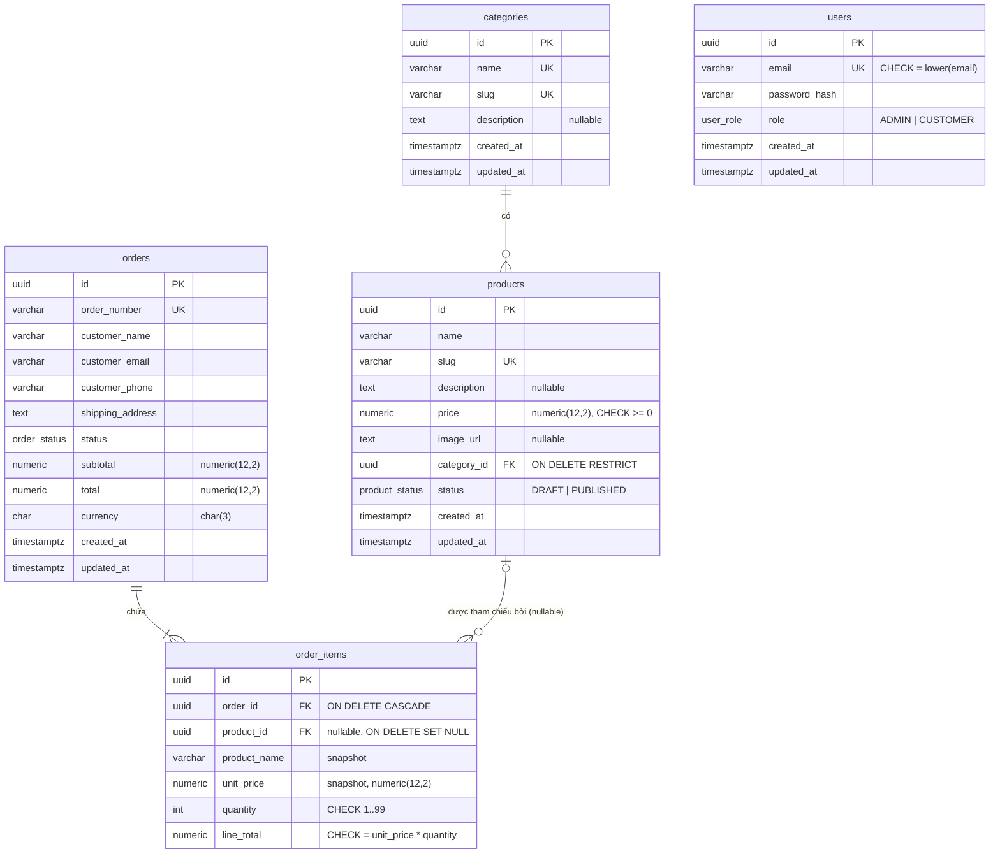
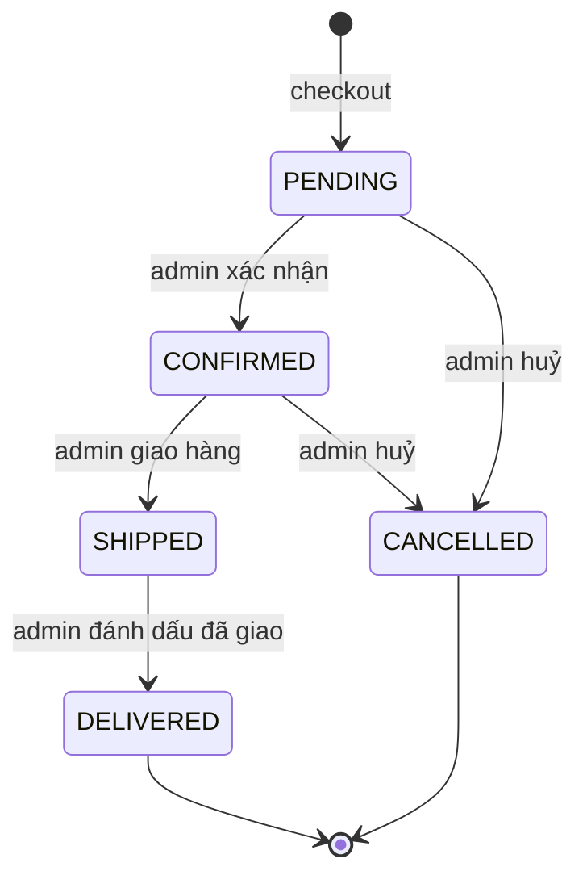

# Database

> **Trạng thái:** thiết kế V1, đã lên kế hoạch chi tiết cho Sprint V1.3 ([IMPLEMENTATION](versions/v1/IMPLEMENTATION.md#sprint-v13--database-schema-with-prisma)). Chưa migrate. Sau đó, `apps/api/prisma/schema.prisma` và SQL của migration trở thành source of truth, còn tài liệu này giải thích *lý do*.

## Sơ đồ quan hệ thực thể (V1)



Ở V1, `users` chỉ tồn tại cho tài khoản admin được seed. Tài khoản khách hàng sẽ có ở V2.

## Quyết định thiết kế và lý do

| Quyết định | Lý do |
|---|---|
| **Primary key UUIDv7, do database sinh** (`@default(dbgenerated("uuidv7()")) @db.Uuid`) | Không làm lộ số lượng bản ghi như kiểu `1, 2, 3…`. v7 được sắp theo thời gian nên việc insert vẫn thân thiện với index, khác với v4 ngẫu nhiên. PostgreSQL 18 có sẵn `uuidv7()`, nên mọi đường insert (Prisma, SQL thuần trong test, psql) đều có ID mà không phải tự sinh. _(Đổi ngày 2026-10-22 từ `@default(uuid(7))`, vốn do Prisma Client sinh.)_ |
| **`numeric(12,2)` cho tiền** | Tính toán thập phân chính xác. Với số thực dấu phẩy động, `0.1 + 0.2 ≠ 0.3`. Xem [ADR-0003](decisions/0003-money-representation.md). |
| **`timestamptz(3)`** cho mọi mốc thời gian (`@db.Timestamptz(3)`) | Lưu một thời điểm tuyệt đối. `timestamp` thường làm mất múi giờ và gây lỗi khi server và người dùng ở các múi giờ khác nhau. **Phải ghi rõ**: `DateTime` của Prisma mặc định thành `timestamp(3)` không có múi giờ. Độ chính xác 3 (mili giây) khớp với `Date` của JavaScript. `created_at` và `updated_at` có `DEFAULT now()` trong DB; `updated_at` do Prisma Client cập nhật (`@updatedAt`), nên một câu `UPDATE` viết tay sẽ không đổi nó. |
| **Bảng `orders`, không phải `order`** | `ORDER` là từ khoá dành riêng của SQL. Model Prisma giữ tên PascalCase và dùng `@@map` để ánh xạ sang bảng snake_case. |
| **Xoá danh mục = `RESTRICT`** | Xoá một danh mục không được âm thầm xoá hay bỏ mồ côi các sản phẩm của nó. API chuyển lỗi vi phạm FK thành `409 Conflict`. |
| **Xoá sản phẩm → `order_items.product_id SET NULL`** | Lịch sử đơn hàng vẫn còn sau khi xoá sản phẩm. Thông thường admin nên **unpublish** thay vì xoá. |
| **Snapshot trong order item** (`product_name`, `unit_price`) | Đơn hàng là bản ghi lịch sử về số tiền khách đã đồng ý trả. Nếu nó join với bản ghi sản phẩm hiện tại, việc đổi tên hay đổi giá sản phẩm sẽ viết lại các đơn hàng, hoá đơn và báo cáo doanh thu trong quá khứ. |
| **Lưu `line_total` + CHECK** | Lưu sẵn giúp báo cáo đơn giản. CHECK constraint `line_total = unit_price * quantity` giúp database từ chối bản ghi không nhất quán ngay cả khi code ứng dụng có bug. |
| **`UNIQUE (order_id, product_id)`** | Mỗi sản phẩm chỉ có một dòng trong mỗi đơn hàng. API gộp các product ID trùng nhau từ cart trước khi insert. |
| **Lưu cả `subtotal` và `total`** | Ở V1 hai giá trị bằng nhau. Phí vận chuyển, thuế và giảm giá ở các phiên bản sau sẽ nằm giữa hai giá trị này mà không cần thiết kế lại schema. |
| **`currency char(3)`** | V1 chỉ có một loại tiền tệ cho cửa hàng (`STORE_CURRENCY`, là **EUR**, [ADR-0003](decisions/0003-money-representation.md)). Ghi lại nó trên đơn hàng không tốn gì và tránh nhập nhằng về sau. |
| **Email chữ thường + CHECK** | API chuyển email về chữ thường trước khi lưu, và CHECK `email = lower(email)` bắt buộc điều đó ở tầng DB. Thiếu nó, `Admin@x` và `admin@x` qua được unique index và thành hai user. |
| **`shipping_address` là một trường text** | Cố ý đơn giản hoá cho V1. Địa chỉ có cấu trúc (đường, thành phố, mã bưu chính, quốc gia) là việc của V2. |
| **V1 không có cột tồn kho** | V1 **không** quản lý tồn kho. Mọi sản phẩm đã publish đều đặt mua được. Tồn kho và reservation khi có truy cập đồng thời thuộc V2. Chúng ta nói rõ điều này thay vì giả vờ là có. |

## Độ dài cột (V1)

| Cột | Kiểu | Lý do |
|---|---|---|
| `categories.name`, `products.name`, `order_items.product_name` | `varchar(200)` | Đủ cho tên sản phẩm dài; giới hạn để tránh dữ liệu rác. |
| `categories.slug`, `products.slug` | `varchar(200)` | Slug sinh từ tên nên cùng giới hạn. |
| `orders.order_number` | `varchar(11)` | `PM-` + 8 ký tự. |
| `orders.customer_name` | `varchar(200)` | |
| `orders.customer_email`, `users.email` | `varchar(254)` | Độ dài tối đa thực tế của một địa chỉ email. |
| `orders.customer_phone` | `varchar(32)` | Đủ cho định dạng quốc tế có dấu cách. |
| `users.password_hash` | `varchar(255)` | Chuỗi argon2id dài khoảng 100 ký tự; chừa chỗ nếu đổi tham số. |
| `orders.currency` | `char(3)` | Mã ISO 4217. |
| `*.description`, `products.image_url`, `orders.shipping_address` | `text` | Không có giới hạn tự nhiên. Giới hạn độ dài (ví dụ image URL) được kiểm tra ở API (V1.9). |

## Index (V1)

| Index | Phục vụ |
|---|---|
| `categories(slug)` unique | Tra cứu trang danh mục |
| `products(slug)` unique | Tra cứu trang chi tiết sản phẩm |
| `products(status, created_at DESC)` | Danh sách "sản phẩm mới publish" trên storefront |
| `products(category_id, status)` | Trang danh mục, lọc theo đã publish |
| `orders(order_number)` unique | Trang xác nhận / tìm kiếm của admin |
| `orders(status, created_at DESC)` | Danh sách đơn hàng của admin, lọc theo trạng thái |
| `orders(created_at DESC)` | Danh sách đơn hàng của admin, không lọc |
| `order_items(order_id)` | Tải các dòng của một đơn hàng |
| `order_items(product_id)` | Index cho FK (PostgreSQL **không** tự động tạo index cho cột FK). Cần cho `SET NULL` khi xoá sản phẩm. |

## Các constraint mà ngôn ngữ schema của Prisma không diễn đạt được

Prisma schema không có `CHECK` constraint. Chúng ta thêm chúng bằng SQL viết tay bên trong một migration tạo bởi `prisma migrate dev --create-only`. Đây là một bài tập có chủ đích trong V1.3:

```sql
ALTER TABLE products    ADD CONSTRAINT products_price_nonnegative CHECK (price >= 0);
ALTER TABLE order_items ADD CONSTRAINT order_items_quantity_range CHECK (quantity BETWEEN 1 AND 99);
ALTER TABLE order_items ADD CONSTRAINT order_items_line_total_consistent CHECK (line_total = unit_price * quantity);
ALTER TABLE orders      ADD CONSTRAINT orders_totals_nonnegative CHECK (subtotal >= 0 AND total >= 0);
ALTER TABLE users       ADD CONSTRAINT users_email_lowercase CHECK (email = lower(email));
```

## Vòng đời đơn hàng (V1)



Các bước chuyển trạng thái được thực thi trong `OrdersService`. Bất kỳ bước chuyển nào không có trong sơ đồ trên đều trả về `409 Conflict`.

**Hướng phát triển đã lên kế hoạch (V3, thanh toán bằng thẻ):** một cột `payment_method` (`COD` | `CARD`; các bản ghi hiện có được backfill thành `COD`), các trạng thái mới `AWAITING_PAYMENT` và `PAID`, một bảng `payments` (một đơn hàng → nhiều lần thử thanh toán), và một bảng `stripe_events` để khử trùng lặp webhook. V1 cố ý không xây sẵn những thứ này. Thêm chúng sau này là một bài tập về tiến hoá schema. Xem [ADR-0005](decisions/0005-online-payments-stripe.md).

## Mã đơn hàng

Định dạng `PM-` + 8 ký tự Crockford base32, ví dụ `PM-7K3Q9X2A`. Giá trị là ngẫu nhiên nên không làm lộ số lượng đơn hàng (một sequence thì sẽ lộ). Nó được bảo vệ bởi unique index, và việc sinh mã sẽ thử lại trong trường hợp hiếm hoi bị trùng. Mã dễ đọc qua điện thoại.
