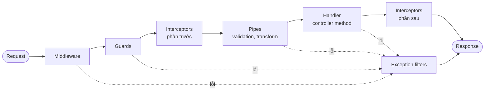

# NestJS cơ bản (nền tảng cho V1.2 trở đi)

> Ghi chú này được viết ở đầu V1.2, trước khi code. Đọc xong, bạn phải giải thích được module, provider, DI và thứ tự xử lý một request. Đó là điều kiện để bắt đầu mục 3 của sprint.

## 1. Nó là gì
NestJS là framework backend cho Node.js, viết bằng TypeScript. Nó tổ chức code thành **module**, dùng **decorator** để khai báo (`@Controller`, `@Get`, `@Injectable`) và có **dependency injection (DI)** để nối các phần với nhau. Bên dưới, V1.2 chạy trên Express (adapter mặc định).

## 2. Tại sao nó tồn tại
Express cho bạn gần như tự do hoàn toàn. Với dự án nhỏ, điều đó tiện. Khi số route, service và người tham gia tăng lên, mỗi người tự tổ chức một kiểu và code trở nên khó đoán. Nest áp đặt một cấu trúc (tương tự Spring hay Angular), nên mọi module trông giống nhau.

## 3. Vấn đề nó giải quyết
- **Tách trách nhiệm.** Controller chỉ nhận request và trả response. Logic nằm trong service. Truy cập DB nằm trong một service riêng.
- **Test được.** Service nhận dependency qua constructor, nên test có thể thay bằng bản giả mà không cần DB thật.
- **Xử lý chung ở một chỗ.** Validation, định dạng lỗi, logging và auth là các mối quan tâm cắt ngang (cross-cutting). Nest có chỗ riêng cho từng việc: pipe, filter, guard, interceptor. Không phải rải `if` khắp các handler.

## 4. Ví dụ đời thực
Coi một công ty:
- **Module** là một phòng ban (Catalog, Orders, Admin). Phòng khai báo những gì nó cần (`imports`), những gì nó có (`providers`, `controllers`), và những gì nó cho phòng khác dùng (`exports`).
- **Provider** (ví dụ `ProductsService`) là một nhân viên với một nhiệm vụ rõ ràng.
- **Controller** là lễ tân: nhận yêu cầu từ khách và chuyển cho đúng nhân viên.
- **DI** là bộ phận nhân sự. Bạn ghi trong constructor "tôi cần một `ProductsService`", Nest tự tìm và đưa vào. Bạn không tự `new` nó.
- **Singleton** (mặc định) là một người giữ chức vụ đó cho cả công ty, mọi phòng dùng chung.

## 5. Cách hoạt động

### 5.1 Decorator và metadata
Decorator gắn thông tin vào class và method. Lúc khởi động, Nest đọc thông tin này để biết route nào map tới method nào. Với DI, Nest đọc **kiểu** của tham số constructor nhờ `emitDecoratorMetadata` trong `tsconfig.json`.

```ts
@Controller('products')
export class ProductsController {
  constructor(private readonly products: ProductsService) {}

  @Get(':id')
  findOne(@Param('id') id: string) {
    return this.products.findById(id);
  }
}
```

### 5.2 Module
```ts
@Module({
  imports: [ConfigModule.forRoot({ isGlobal: true, validate })],
  controllers: [HealthController],
  providers: [],
})
export class AppModule {}
```
- `AppModule` là module gốc. `main.ts` tạo app từ nó.
- Provider **không được `exports`** thì module khác không inject được. Lỗi `Nest can't resolve dependencies` thường là dấu hiệu của chuyện này.
- `@Global()` làm module dùng được ở mọi nơi mà không cần `imports`. Tiện, nhưng che giấu phụ thuộc, nên dùng có chừng mực.

### 5.3 Provider và scope
`@Injectable()` đánh dấu class là provider. Mặc định là **singleton**: một instance cho cả app. Vì vậy **không lưu state riêng của một request** trong một service singleton. Ví dụ lưu `currentUser` vào field của service: hai request đồng thời sẽ ghi đè lên nhau. Đây là lỗi kinh điển.

### 5.4 Request lifecycle

Quy tắc cần nhớ:
- **Middleware** xử lý request thô, trước khi Nest biết route nào sẽ chạy.
- **Guard** quyết định cho đi tiếp hay chặn. Guard chạy trước pipe, nên request không được phép bị chặn trước khi bị validate.
- **Interceptor** bọc quanh handler: đo thời gian, đổi response. Nó chạy hai lần: trước và sau handler.
- **Pipe** kiểm tra và biến đổi input trước khi handler chạy.
- **Filter** bắt exception ở mọi tầng và quyết định response lỗi.

### 5.5 Đăng ký global, controller hay route
Một pipe hoặc filter có thể đăng ký ở ba cấp: toàn app (`app.useGlobalPipes`), controller (`@UsePipes`), hoặc method. Khi pipe hoặc filter cần inject service, đăng ký bằng provider `APP_PIPE` / `APP_FILTER` trong module. `app.useGlobal...` không có DI. V1.2 dùng cách provider.

### 5.6 Validation
DTO là class khai báo hình dạng của input, dùng decorator của `class-validator`:
```ts
class CreateProductDto {
  @IsString()
  @IsNotEmpty()
  name!: string;

  @IsOptional()
  @IsString()
  note?: string;
}
```
`ValidationPipe` kiểm tra DTO:
- `whitelist: true`: xoá field không có decorator nào.
- `forbidNonWhitelisted: true`: thay vì xoá, trả `400` khi có field lạ. Chỉ có tác dụng khi `whitelist: true`.
- `transform: true`: chuyển body thành instance của DTO và ép kiểu theo khai báo.

### 5.7 Config
`process.env` luôn là **chuỗi**: `PORT=4000` đọc ra là `"4000"`. `ConfigModule` với hàm `validate` kiểm tra và ép kiểu một lần lúc khởi động. Sau đó lấy giá trị qua `ConfigService`. Đây là lý do app từ chối khởi động khi thiếu biến bắt buộc, thay vì lỗi ở request đầu tiên.

### 5.8 Exception filter
Khi có exception không được xử lý, filter `@Catch()` nhận `ArgumentsHost`, lấy `request` và `response`, rồi gửi response theo định dạng chung. Nếu không có filter, Nest trả định dạng mặc định, không có `requestId`.

### 5.9 Test
`Test.createTestingModule({...}).compile()` dựng một module giống app thật. `app.init()` rồi dùng `supertest` gọi HTTP. Muốn test một service độc lập, đưa bản giả vào `providers` thay cho bản thật.

## 6. Khi nào nên dùng
- Backend có nhiều module và nhiều người phát triển, cần cấu trúc và test nhất quán. PixelMart từ V1.2 thuộc loại này.
- Cần DI để thay dependency khi test, hoặc đổi implementation. Ví dụ đổi cache sang Redis ở V9.

## 7. Khi nào không nên dùng
- Một script hoặc một hàm serverless nhỏ: Nest thêm nhiều khái niệm không cần thiết.
- Khi chưa hiểu HTTP và Express: Nest che bớt chi tiết, nên dễ dùng sai mà không hiểu vì sao. Đọc [http-and-rest.md](http-and-rest.md) trước.
- Khi cần kiểm soát từng chi tiết của request và response: dùng Express hoặc Fastify trực tiếp.

## 8. Vị trí trong PixelMart
- **V1.2:** `apps/api` có `AppModule` (ConfigModule, LoggerModule, HealthModule), `common/filters/`, `config/env.schema.ts` (zod). Feature module nằm trong `modules/<tên>/`.
- **V1.3 (dự kiến):** `PrismaModule` với `PrismaService` được export.
- **V1.4 (dự kiến):** `CatalogModule`.
- **V1.7 (dự kiến):** module đơn hàng và checkout.
- **V1.8 (dự kiến):** `AuthModule` cùng các guard.

## 9. Bài tập thực hành
Làm sau khi V1.2 chạy được, trên một nhánh thử nghiệm, **không commit**:
1. Tạo `ClockService` (`@Injectable()`) trả về `new Date()`. Khai báo nó trong `HealthModule.providers`, inject vào `HealthController`, và dùng nó để trả timestamp của `GET /health`.
2. Xoá `@Injectable()` khỏi `ClockService`, rồi chạy app. Đọc lỗi `Nest can't resolve dependencies`. Vì sao lỗi xuất hiện ngay lúc khởi động?
3. Bỏ `ClockService` khỏi `providers`, rồi đọc lỗi. So sánh với lỗi ở bước 2. Hai lỗi có giống nhau không?
4. Viết unit test cho `HealthController` bằng cách truyền một `ClockService` giả trả về ngày cố định. Vì sao DI làm việc này dễ?
5. Trên giấy: vẽ lại thứ tự request lifecycle. Đánh dấu chỗ bạn sẽ đặt: kiểm tra token, validate body, đo thời gian xử lý, định dạng lỗi.

## 10. Lỗi thường gặp và cách debug
- **`Nest can't resolve dependencies of X (?)`**: provider chưa khai báo trong module, hoặc chưa được export từ module nguồn, hoặc class được inject đang import bằng `import type`. Với `import type`, metadata không được phát ra và Nest không biết cần inject gì. Với class được inject, dùng import thường.
- **Circular dependency**: hai file import nhau. Nest báo lỗi lúc khởi động. Sửa bằng cách tách phần dùng chung ra file hoặc module riêng.
- **Hai request ghi đè nhau**: lưu state của request trong service singleton.
- **`PORT` là chuỗi `"4000"`**: so sánh hoặc tính toán sai. Dùng `ConfigService` đã được validate và ép kiểu.
- **DTO thiếu decorator**: với `whitelist`, field bị mất âm thầm. Với `forbidNonWhitelisted`, client nhận `400` với thông báo "property x should not exist". Kiểm tra cả hai cấu hình.
- **Test xanh nhưng production lỗi**: e2e không dùng cùng pipe và filter với `main.ts`. Cách khắc phục là dùng chung `configureApp`.
- **Debug**: `nest start --debug` rồi attach debugger. Sau V1.2, đặt `LOG_LEVEL=debug` để xem log chi tiết hơn.

## 11. Câu hỏi phỏng vấn
- DI là gì, và nó giúp việc test như thế nào?
- Singleton và request scope khác nhau thế nào? Rủi ro khi lưu state trong singleton là gì?
- Module `exports` và provider khác nhau thế nào?
- Middleware, guard, interceptor, pipe và filter: mỗi cái làm gì, và thứ tự chạy ra sao?
- Vì sao validation nên đặt ở pipe chứ không chỉ ở service?

## 12. Tài liệu chính thức
- First steps: https://docs.nestjs.com/first-steps
- Controllers: https://docs.nestjs.com/controllers
- Providers: https://docs.nestjs.com/providers
- Modules: https://docs.nestjs.com/modules
- Request lifecycle: https://docs.nestjs.com/faq/request-lifecycle
- Pipes: https://docs.nestjs.com/pipes
- Exception filters: https://docs.nestjs.com/exception-filters
- Configuration: https://docs.nestjs.com/techniques/configuration
- Validation: https://docs.nestjs.com/techniques/validation
- Testing: https://docs.nestjs.com/fundamentals/testing
- OpenAPI (Swagger): https://docs.nestjs.com/openapi/introduction
